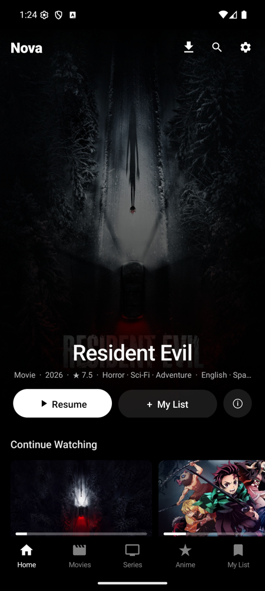
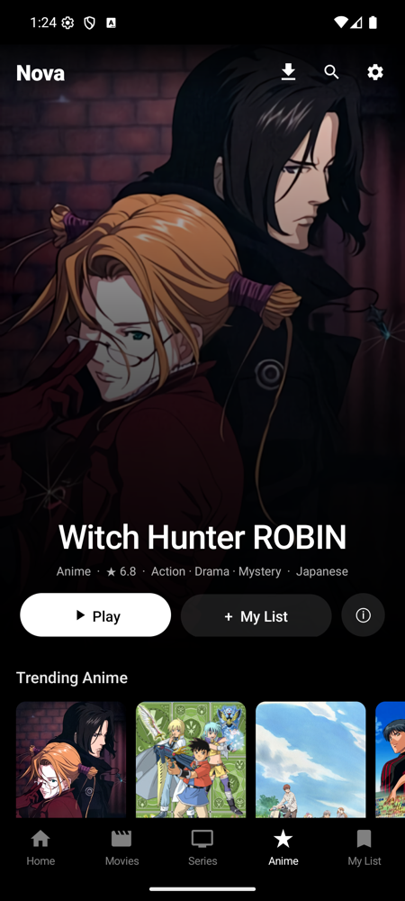
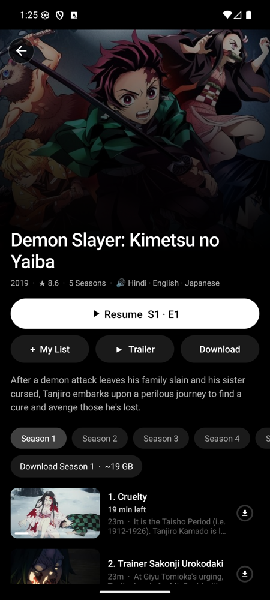
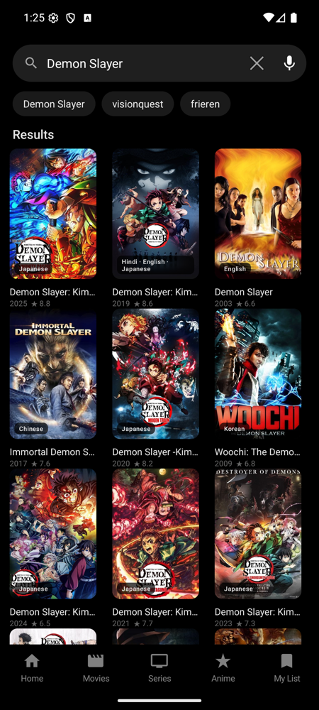
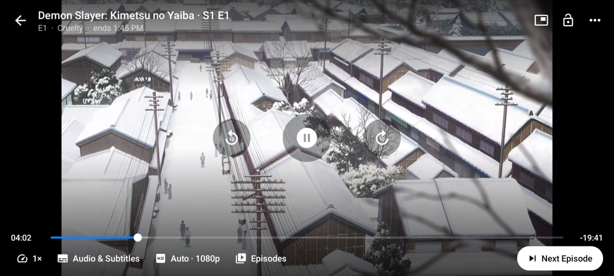
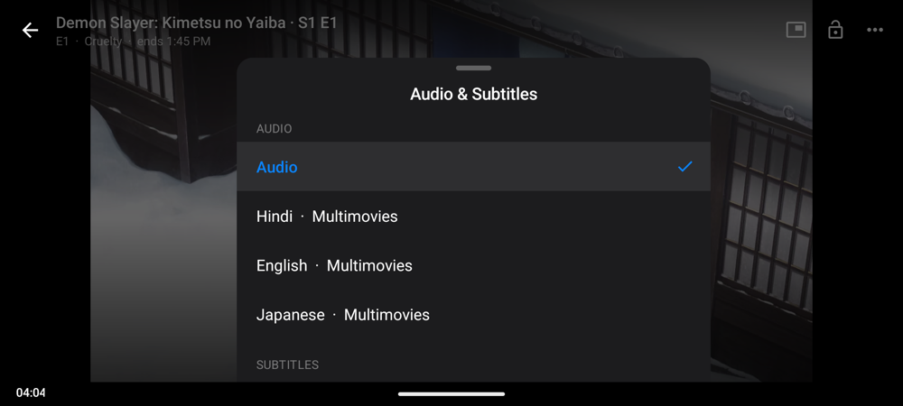
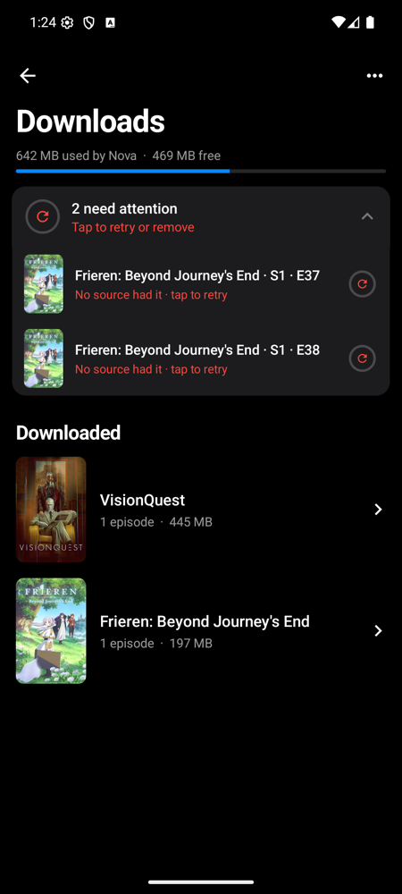

# Nova Mobile

A fast, lightweight Android app for movies, series and anime: browse TMDB and AniList, stream from many sources at once, pick any audio language the sources have, and download for offline viewing.

[](https://github.com/anees-dahot/Nova-Mobile/releases/latest)


[](LICENSE)

**[Download the latest APK](https://github.com/anees-dahot/Nova-Mobile/releases/latest)**

## Screenshots

| Home | Anime | Title | Search |
|---|---|---|---|
|  |  |  |  |

| Player | Every language from every source |
|---|---|
|  |  |

| Downloads |
|---|
|  |

## Features

**Browse**
- Movies and series from TMDB, anime from AniList, with Bollywood, Hindi series, Pakistani dramas and anime rows
- Continue Watching, My List, Top 10 Today, instant search with voice input
- Audio-language tags on cards (e.g. "Hindi · English · Japanese"), based on what the streams really carry
- Airing calendar and new-episode alerts

**Streaming**
- Source race: every multi-audio source is asked at once (web pages staggered 4s apart to spare RAM); after the first answer the others get 5 more seconds, and the stream with the most real audio languages wins, with yours first
- Languages are read from the stream itself (HLS, DASH and MP4 manifests), not guessed from a source's label
- One language menu for all sources: picking a language the current stream lacks switches source and resumes at the same second; video and audio always come from the same stream, so nothing drifts out of sync
- If a stream fails, the other streams already found are tried before searching again
- Quality gate: sub-720p streams are skipped while better ones remain; max quality cap (720p / 1080p / 4K)
- 15+ sources, including fast HTTP resolvers with no WebView (NetMirror, Multimovies, Vegamovies, VaPlayer, Braflix, AnimeSalt, Anime World India, ZokoAnime)

**Player**
- Gestures for brightness, volume and seeking; picture-in-picture; screen lock; aspect modes
- Resume prompt, skip intro/outro (AniSkip), next-episode card, sleep timer, playback speed, volume boost
- Subtitles cleaned of ads, with size options

**Downloads**
- Saves the stream with the most audio languages and every subtitle
- Size and time left, storage bar, rich notifications, retry for failed items, Smart Downloads
- Offline: Home shows your downloads first, even when nothing else can load

**Accounts**
- Sync watch progress with Trakt (movies and series), AniList and MyAnimeList (anime)

## Install

1. Download `Nova-Mobile-<version>.apk` from [Releases](https://github.com/anees-dahot/Nova-Mobile/releases/latest).
2. Open it on your phone and allow installing from this source.

Requires Android 8.0 or newer.

## Build from source

1. Get a free TMDB API key: https://www.themoviedb.org/settings/api
2. Add it to `local.properties` (not committed):
   ```
   tmdb.key=YOUR_KEY
   ```
3. Build: `./gradlew assembleRelease` → `app/build/outputs/apk/release/app-release.apk`
4. Install: `adb install -r app/build/outputs/apk/release/app-release.apk`

## Account sync (Trakt, AniList, MyAnimeList)
Each service needs a free app registration; put the IDs in `local.properties` and rebuild.

| Service | Register at | Redirect / notes | local.properties |
|---|---|---|---|
| Trakt | https://trakt.tv/oauth/applications/new | Redirect URI: `urn:ietf:wg:oauth:2.0:oob` (device login) | `trakt.clientId=…` and `trakt.clientSecret=…` |
| AniList | https://anilist.co/settings/developer | Redirect URL: `novamobile://anilist` | `anilist.clientId=…` |
| MyAnimeList | https://myanimelist.net/apiconfig | App type "other", Redirect URL: `novamobile://mal` | `mal.clientId=…` |

Then Settings → Accounts → Connect. Movies/series sync with Trakt; anime with AniList / MAL.

## Disclaimer

This app does not host any content. It only shows metadata from TMDB and AniList and plays streams from third-party providers; availability and legality of those streams depend on your region.

## License

GPL-3.0 (see [LICENSE](LICENSE)). Parts of the source resolvers are ported from [Indflix](https://github.com/dipender98/Indflix); see [NOTICE](NOTICE) for credits.
